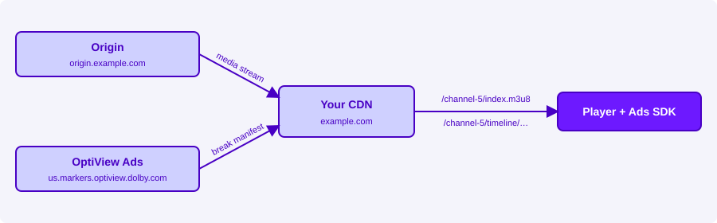

# Serve the Break Manifest from your CDN

By default, your player fetches your stream from your CDN, while the OptiView Ads SDK fetches the [Break Manifest](../concepts/break-manifest.mdx) from the OptiView Ads domain of your region. This guide shows how to serve the Break Manifest from **your own domain** instead, by letting your CDN forward a path to OptiView Ads. Your app then fetches everything from one domain you control:

| Resource       | Default                                                                        | Served from your CDN                                                   |
| -------------- | ------------------------------------------------------------------------------ | ---------------------------------------------------------------------- |
| Stream         | `https://example.com/channel-5/index.m3u8`                                     | `https://example.com/channel-5/index.m3u8`                             |
| Break Manifest | `https://us.markers.optiview.dolby.com/manifest/v1/ORG-ID/channels/CHANNEL-ID` | `https://example.com/channel-5/manifest/v1/ORG-ID/channels/CHANNEL-ID` |

No change is needed on the OptiView Ads side: the setup is a routing rule on your CDN and a different `manifestUrl` in your player.

:::note[Regional domains]
The examples on this page use the US region (`https://us.markers.optiview.dolby.com`). For the EU region, replace `us.` with `eu.` (`https://eu.markers.optiview.dolby.com`).
:::

## How it works

Your CDN gets one extra routing rule. Requests for the stream go to your origin as today; requests for the Break Manifest path are forwarded to OptiView Ads. Your app only sees your domain.



OptiView Ads keeps producing the Break Manifest exactly as before, including its caching headers and signature. Your CDN only needs to pass the response through unchanged.

## Before you start

You need:

- **Your organization ID and the channel ID.** They are part of the channel's Break Manifest URL; see [retrieving the required values](../player-integration/optiview-ads-sdk/index.mdx#retrieving-the-required-values). On this page, `ORG-ID` and `CHANNEL-ID` are placeholders for these values.
- **The OptiView Ads domain of your organization's region.** Use the same region (`us.` or `eu.`) as the OptiView Ads API you work with today.

  | Region | OptiView Ads domain             |
  | ------ | ------------------------------- |
  | US     | `us.markers.optiview.dolby.com` |
  | EU     | `eu.markers.optiview.dolby.com` |

- **Access to your CDN's routing configuration.** Your CDN must be able to route a path to a different origin. For the recommended approach in step 1, it must also remove a path prefix on the way, which most CDNs support through path rewrite rules or edge functions.

## Step 1: Choose the Break Manifest URL

Pick the URL the SDK will use for the Break Manifest. In both approaches below, the URL ends with the OptiView Ads path (`/manifest/v1/ORG-ID/channels/CHANNEL-ID`). Your CDN forwards that path unchanged, so one rule serves every channel and future versions of the endpoint need no CDN change.

| Approach                                | Example                                                                | CDN rule                                                               |
| --------------------------------------- | ---------------------------------------------------------------------- | ---------------------------------------------------------------------- |
| **Next to each stream** (recommended)   | `https://example.com/channel-5/manifest/v1/ORG-ID/channels/CHANNEL-ID` | Drop everything before `/manifest/`, forward the rest.                 |
| **One path for all channels** (simpler) | `https://example.com/manifest/v1/ORG-ID/channels/CHANNEL-ID`           | Forward every request under `/manifest/` unchanged, without a rewrite. |

- **Next to each stream** places the Break Manifest under the same path as the stream it belongs to, so both share your stream's routing and logging.
- **One path for all channels** keeps the CDN configuration to a single rule without any path rewrite.
- In both cases, make sure none of your own content is served under a `/manifest/` path on the same domain, so the rule only matches Break Manifest requests.

## Step 2: Forward the path to OptiView Ads

Add a rule on your CDN that sends the Break Manifest requests to OptiView Ads, with everything from `/manifest/v1` onwards forwarded unchanged:

| Approach                      | Incoming request                                                       | Forwarded to                                                                   |
| ----------------------------- | ---------------------------------------------------------------------- | ------------------------------------------------------------------------------ |
| **Next to each stream**       | `https://example.com/channel-5/manifest/v1/ORG-ID/channels/CHANNEL-ID` | `https://us.markers.optiview.dolby.com/manifest/v1/ORG-ID/channels/CHANNEL-ID` |
| **One path for all channels** | `https://example.com/manifest/v1/ORG-ID/channels/CHANNEL-ID`           | `https://us.markers.optiview.dolby.com/manifest/v1/ORG-ID/channels/CHANNEL-ID` |

Configure the OptiView Ads origin in your CDN as follows:

- **Protocol:** HTTPS on port 443.
- **Host header and TLS server name (SNI):** the OptiView Ads domain of your region, not your own domain. OptiView Ads routes requests by host name.
- **Methods:** `GET`, `HEAD`, and `OPTIONS`.
- **Forwarded request headers:** none are required. Do not forward cookies or authorization headers; the Break Manifest endpoint is public and ignores them.

## Step 3: Keep the response intact

Your CDN must deliver the Break Manifest response to the player as OptiView Ads sends it. Check each of the following, because a miss can stop ads silently while your stream keeps playing:

| Requirement                                   | Why                                                                                                                                                                                                                                                     | If it is missed                                                                         |
| --------------------------------------------- | ------------------------------------------------------------------------------------------------------------------------------------------------------------------------------------------------------------------------------------------------------- | --------------------------------------------------------------------------------------- |
| **Forward the `X-Manifest-Signature` header** | Every Break Manifest response is signed. The SDK verifies the signature before it uses the manifest.                                                                                                                                                    | The SDK rejects the manifest and schedules no breaks.                                   |
| **Do not modify the body**                    | The signature covers the exact response body. Compression (gzip, Brotli) is fine; minifying, reformatting, or injecting content is not.                                                                                                                 | The signature no longer matches; the SDK rejects the manifest and schedules no breaks.  |
| **Respect the origin's `Cache-Control`**      | For live channels, the cache lifetime equals the channel's active polling interval (1 second by default), so players learn about new breaks and changes in time.                                                                                        | Players receive breaks late or miss them.                                               |
| **Keep the CORS headers** (web)               | Browsers need `Access-Control-Allow-Origin` to read the response, and `Access-Control-Expose-Headers: X-Manifest-Signature` to let the SDK read the signature. CDNs pass them through by default; if yours sets its own, expose `X-Manifest-Signature`. | The browser blocks the request, or hides the signature so the SDK rejects the manifest. |

## Step 4: Point the SDK at your URL

Pass your own URL as the `manifestUrl` when you start the session. Nothing else in your integration changes. See the [OptiView Ads SDK](../player-integration/optiview-ads-sdk/index.mdx) documentation for the full integration.

import Tabs from '@theme/Tabs';
import TabItem from '@theme/TabItem';

<Tabs groupId="platform" queryString>
  <TabItem value="web" label="Web">

```typescript
await sdk.startSession({
  manifestUrl: 'https://example.com/channel-5/manifest/v1/ORG-ID/channels/CHANNEL-ID',
});
```

  </TabItem>
  <TabItem value="android" label="Android">

```kotlin
sdk.startSession(
    SessionConfig(
        manifestUrl = "https://example.com/channel-5/manifest/v1/ORG-ID/channels/CHANNEL-ID",
    )
)
```

  </TabItem>
  <TabItem value="ios" label="iOS">

```swift
try await sdk.startSession(
    SessionConfig(
        manifestUrl: "https://example.com/channel-5/manifest/v1/ORG-ID/channels/CHANNEL-ID"
    )
)
```

  </TabItem>
  <TabItem value="react-native" label="React Native">

```typescript
await ads.startSession({
  manifestUrl: 'https://example.com/channel-5/manifest/v1/ORG-ID/channels/CHANNEL-ID',
});
```

  </TabItem>
</Tabs>

## Verify your setup

Request the Break Manifest through your CDN and check the response headers:

```bash
curl -s -D - -o /dev/null -H 'Origin: https://www.example.com' 'https://example.com/channel-5/manifest/v1/ORG-ID/channels/CHANNEL-ID'
```

A working setup returns:

```text
HTTP/2 200
content-type: application/json; charset=utf-8
cache-control: public, max-age=1
access-control-allow-origin: *
access-control-expose-headers: X-Manifest-Signature
x-manifest-signature: eyJhbGciOiJFZERTQSIs...
```

Check that:

- the status is `200` and the body is the channel's Break Manifest, with the expected `channelId`;
- `x-manifest-signature` is present;
- `cache-control` shows the same `max-age` as a request made directly to the OptiView Ads domain.

Then play the channel with the new `manifestUrl` and confirm that a break plays. If the SDK rejects the manifest, it reports the `DA-MANIFEST-SIGNATURE-INVALID` diagnostic.

## Troubleshooting

| Symptom                                                  | Likely cause                                                                                                                                |
| -------------------------------------------------------- | ------------------------------------------------------------------------------------------------------------------------------------------- |
| `404 Not found` from your URL                            | The rule forwards the wrong path (it must start at `/manifest/v1`), the IDs are wrong, or the CDN forwards to the domain of another region. |
| Error page from OptiView Ads, or a TLS error             | The `Host` header or TLS server name is set to your domain instead of the OptiView Ads domain.                                              |
| Stream plays, no breaks, `DA-MANIFEST-SIGNATURE-INVALID` | The `X-Manifest-Signature` header is stripped, the body is modified, or (on web) the header is not exposed through CORS.                    |
| Breaks start late or changes arrive late                 | Your CDN caches the Break Manifest longer than the origin's `Cache-Control` allows.                                                         |
| Works in the apps but not in the browser                 | CORS headers are missing or replaced on the way through your CDN.                                                                           |

## Related resources

| Resource                                                             | Description                                                  |
| -------------------------------------------------------------------- | ------------------------------------------------------------ |
| [Break Manifest](../concepts/break-manifest.mdx)                     | The side-loaded contract between the backend and the player. |
| [Workflow integration](./workflow-integration.md)                    | How OptiView Ads fits into your existing delivery workflow.  |
| [OptiView Ads SDK](../player-integration/optiview-ads-sdk/index.mdx) | Integrating the SDK with your player.                        |
