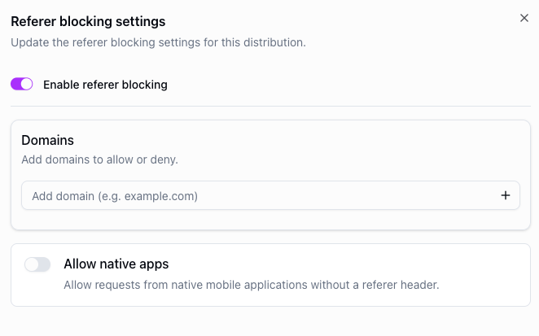

# Referrer blocking

Referrer blocking restricts access to your stream based on the HTTP `Referer` header sent by the viewer's browser. This allows you to control which websites are allowed to embed and play your content.

When enabled, the platform checks the `Referer` header of each playback request against a list of allowed domains. Requests originating from websites that are not on the list are rejected, preventing third parties from embedding your stream on their pages without permission.

## Use cases

- **Embed protection** — ensure your stream can only be played on your own website or approved partner sites.
- **Content piracy prevention** — block unauthorized websites from hotlinking your stream.
- **Partner control** — allow specific resellers or affiliates to embed the stream while blocking everyone else.

Referrer blocking can be configured via the API or the dashboard on a per-distribution basis.

<figure style={{ textAlign: 'center' }}></figure>

## Matching rules

The platform compares the host in the `Referer` header with each entry in the list of allowed domains. A request passes referrer blocking if its host matches at least one entry.

- **Exact domains:** an entry such as `example.com` matches only that exact host, including the port. `example.com` does not match `www.example.com` or `example.com:8443`. Ports are only accepted with `localhost`.
- **Local development:** to test playback locally, add `localhost` with the port of your development server, such as `localhost:3000`. `localhost` without a port only matches a page served on the default port, such as `http://localhost/`. IP addresses such as `127.0.0.1` are not accepted.
- **Wildcards:** an entry such as `*.example.com` matches exactly one subdomain level of letters, digits and hyphens, such as `a.example.com` or `www.example.com`. It does not match `example.com` itself or deeper subdomains such as `a.b.example.com`. Add `example.com` as a separate entry to also allow the bare domain. A wildcard over a shared suffix such as `*.co.uk` allows every site directly under it.
- **Wildcard placement:** `*` is only allowed on its own at the start of an entry, followed by a domain such as `example.com`. Entries such as `*`, `*.com`, `a.*.example.com` and `*example.com` are rejected.
- **Case:** matching is case-insensitive, so `Example.com` and `example.com` are equivalent.
- **Native apps:** requests without a `Referer` header, such as those from native mobile or TV apps, are only allowed when **Allow native apps** (`allowNativeApps` in the API) is enabled. Browsers also omit the header when the embedding page's [Referrer-Policy](https://developer.mozilla.org/en-US/docs/Web/HTTP/Reference/Headers/Referrer-Policy) is `no-referrer` or `same-origin`, so such pages are treated like native apps. The default policy of browsers sends the page's origin, which is all referrer blocking needs.

::::caution[Referrer blocking is not access control]
The `Referer` header is set by the viewer's browser or app, so referrer blocking deters other websites from embedding your stream, but it cannot stop a determined viewer. With **Allow native apps** enabled, any page that omits the header gets through. To restrict who can watch, combine it with [token-based security](./token-based-security.mdx).
::::

## API example

You can also configure referrer blocking via the API using the `security.refererBlocking` object when [creating](../../api/create-channel-distribution.api.mdx) or [updating](../../api/update-distribution.api.mdx) a distribution.

`POST https://api.theo.live/v2/channels/{channelId}/distributions`

```json
{
  "name": "my-distribution",
  "security": {
    "refererBlocking": {
      "enabled": true,
      "allowedDomains": ["example.com", "*.example.com", "partner.com"],
      "allowNativeApps": true
    }
  }
}
```
